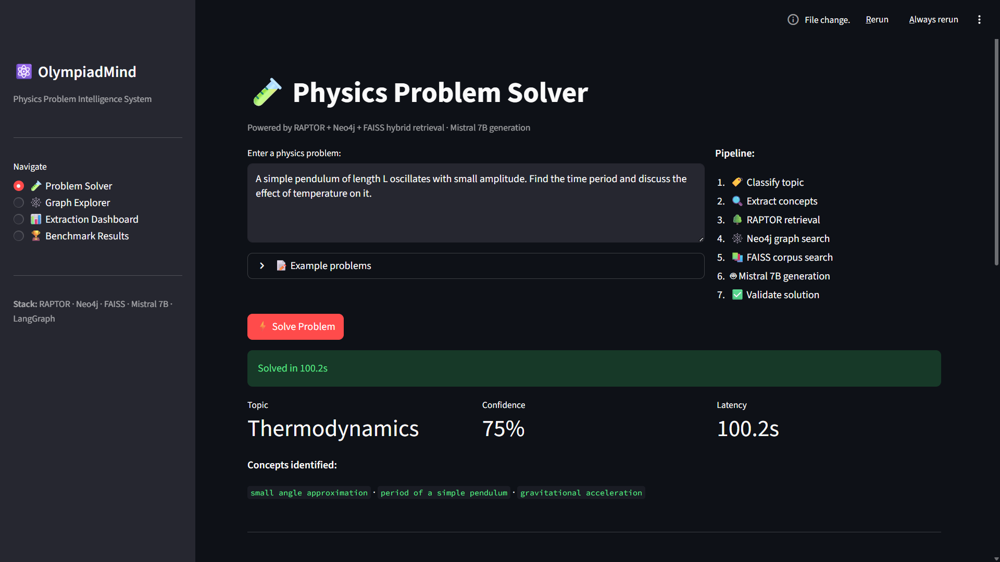
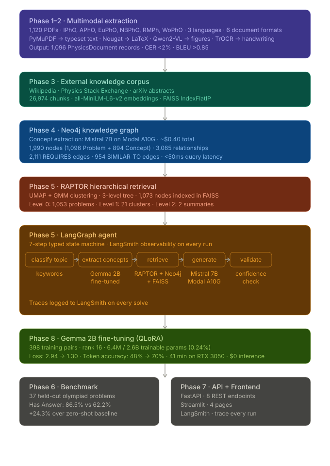

<div align="center">

# OlympiadMind

**Multimodal Physics Document Intelligence System**

1,120 PDFs · RAPTOR Hierarchical Retrieval · Neo4j Knowledge Graph · Gemma 2B Fine-tuning · LangGraph Agent

[](https://www.python.org/)
[](https://pytorch.org/)
[](https://neo4j.com/)
[](https://langchain.com/langgraph)
[](https://fastapi.tiangolo.com/)
[](https://streamlit.io/)
[](https://modal.com/)

</div>

---

## Overview

OlympiadMind ingests 1,120 Physics Olympiad PDFs across 8 source types, 3 languages, and 6 document formats — extracts text, equations, figures, and scanned content — builds a hybrid RAG pipeline over a Neo4j knowledge graph — and benchmarks a fine-tuned Gemma 2B agent against zero-shot Mistral 7B on 37 held-out problems.

**Headline result: +24.3% improvement in complete answer generation over zero-shot baseline.**

## Screenshots



---

## Architecture



---

## Key Results

### Benchmark — OlympiadMind vs Zero-Shot Mistral 7B
37 held-out olympiad problems · same model, different retrieval · isolates RAG contribution

| Metric | OlympiadMind (RAG) | Zero-Shot Mistral 7B | Improvement |
|---|---|---|---|
| Has Answer | **86.5%** | 62.2% | **+24.3%** |
| Has Equations | **100.0%** | 91.9% | +8.1% |
| Has Steps | 100.0% | 100.0% | — |
| Avg Latency | 59.3s | 58.2s | ~same |

> Same model, same hardware — only the retrieval pipeline differs. The +24.3% improvement is attributable entirely to RAPTOR + Neo4j + FAISS hybrid retrieval.

---

### Gemma 2B Fine-Tuning — Concept Extraction

| Metric | Value |
|---|---|
| Base model | google/gemma-2-2b-it |
| Method | QLoRA rank 16, alpha 32 |
| Trainable params | 6.4M / 2.6B (0.24%) |
| Training loss | 2.94 → 1.30 |
| Token accuracy | 48% → 70% |
| Training time | 41 min on RTX 3050 6GB |
| Inference cost | $0 (fully local, offline) |

---

### Knowledge Graph

| Metric | Value |
|---|---|
| Problem nodes | 1,096 |
| Concept nodes | 894 |
| REQUIRES edges | 2,111 |
| SIMILAR_TO edges | 954 |
| Total nodes | 1,990 |
| Total relationships | 3,065 |
| Query latency | < 50ms |

---

### RAPTOR Tree

| Metric | Value |
|---|---|
| Level 0 — leaf problems | 1,053 |
| Level 1 — cluster summaries | 21 |
| Level 2 — topic summaries | 2 |
| Total nodes indexed | 1,073 |

---

## Tech Stack

| Component | Technology | Purpose |
|---|---|---|
| PDF parsing | PyMuPDF | Typeset text, layout detection |
| LaTeX OCR | Meta Nougat | Equation extraction from academic PDFs |
| Handwriting OCR | Microsoft TrOCR | Scanned solution pages |
| Figure understanding | Qwen2-VL | Physics diagram descriptions |
| Multilingual OCR | EasyOCR | Hindi and Marathi documents |
| Vector embeddings | all-MiniLM-L6-v2 | Local, zero cost |
| Vector index | FAISS | 26,974 corpus chunks |
| Knowledge graph | Neo4j AuraDB | Concept relationships, graph traversal |
| Hierarchical retrieval | RAPTOR | 3-level tree over problem corpus |
| RAG agent | LangGraph | Typed state machine, 7 nodes |
| Concept extraction | Gemma 2B (fine-tuned) | QLoRA, runs locally |
| Solution generation | Mistral 7B | Modal A10G GPU |
| Observability | LangSmith | Trace every agent run |
| API | FastAPI | 8 REST endpoints |
| Frontend | Streamlit | 4-page UI |

---

## Dataset

| Source | Files | Content |
|---|---|---|
| olympiad/problems | 569 | IPhO, APhO, EuPhO, NBPhO, RMPh, WoPhO |
| olympiad/solutions | 544 | Born-digital + scanned English |
| science_bowl | 1 | English MCQ format, 143 pages |
| cbse | 1 | Assertion & Reason format |
| hindi | 2 | Born-digital Hindi |
| multilingual | 1 | Marathi cover + English body |
| scanned | 1 | Fully scanned English |
| tabular | 1 | NIST physical constants table |
| **Total** | **1,120** | 8 source types · 3 languages · 6 formats |

---

## Project Status

| Phase | Description | Status |
|---|---|---|
| 1 | Dataset audit + content classification | ✅ Complete |
| 2 | Multimodal extraction pipeline | ✅ Complete |
| 3 | External knowledge corpus | ✅ Complete |
| 4 | Neo4j knowledge graph | ✅ Complete |
| 5 | RAPTOR + hybrid retrieval + LangGraph agent | ✅ Complete |
| 6 | Benchmark evaluation | ✅ Complete |
| 7 | FastAPI + Streamlit frontend | ✅ Complete |
| 8 | Gemma 2B fine-tuning | ✅ Complete |

---

## How to Run

**Option 1 — Docker**
```bash
git clone https://github.com/AmanDataGuy/OlympiadMind
cd OlympiadMind
cp .env.example .env
# fill in NEO4J_URI, NEO4J_USERNAME, NEO4J_PASSWORD, LANGCHAIN_API_KEY, HF_TOKEN
docker-compose up --build
```
FastAPI at `localhost:8000/docs` · Streamlit at `localhost:8501`

> Note: requires `.env` credentials and `data/` folder with FAISS indexes and RAPTOR tree.

**Option 2 — Local**
```bash
pip install -r requirements.txt
python main.py          # terminal 1 — FastAPI
streamlit run app.py    # terminal 2 — Streamlit
```

FastAPI swagger UI at `localhost:8000/docs` · Streamlit UI at `localhost:8501`

---

## Author

[LinkedIn](https://www.linkedin.com/in/aman-dataguy/)
